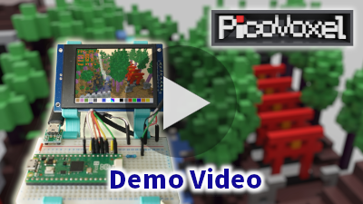
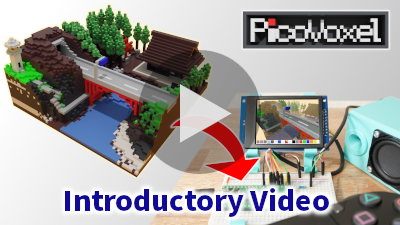
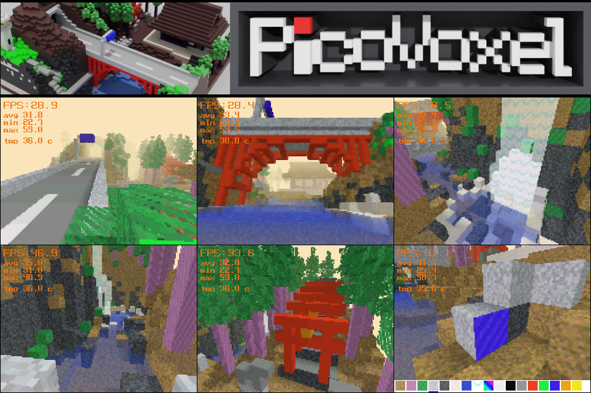
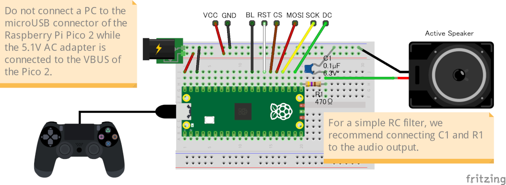

# PicoVoxel

[](https://www.raspberrypi.com/products/raspberry-pi-pico-2/)

[](LICENSE.txt)
[](https://github.com/tryedgetech/PicoVoxel/actions/workflows/firmware-ci.yml)
[](https://github.com/tryedgetech/PicoVoxel/actions/workflows/firmware-release.yml)

**A full 3D voxel world engine running on a single Raspberry Pi Pico 2 (RP2350) — no GPU, 520KB of RAM.**

[](https://youtu.be/xQXyYWDwtNk)
[](https://youtu.be/J9FVm8iH3mc)

---


---

## What is this?

PicoVoxel is a hand-built voxel world rendered entirely in software on a Raspberry Pi Pico 2 — a ~$6 dual-core microcontroller with no dedicated graphics hardware. Every voxel, texture, and shadow you see is pushed to a 320x240 display via software rendering and DMA, at average 30+ FPS.

The included world is a hand-crafted Japanese countryside: ocean, mountains, a river, a waterfall, an elevated bridge, a tunnel, a shrine, and a lighthouse — built inside a 64x64x32 voxel world.

This is a **technical demo / japanese voxel world showcase**, not a full game.

## Features

- 3D Grid DDA Ray Casting Renderer Engine at 320x240, average 30+ FPS
- 64x64x32 voxel world with a fully hand-built Japanese countryside scene
- Block placement and destruction
- 17 block types, including transparent blocks (water, waterfalls) and animated blocks
- Distance fog for far-plane rendering, and block shadow rendering
- Free-fly camera in Edit Mode; jump and first-person movement in Play Mode
- Full yaw/pitch/roll camera control
- USB PS controller support (via TinyUSB)
- Positional/environmental audio: waterfall, river, waves, cicadas, crows
- UI/action sound effects: block selection, mode switching, jump, landing
- Waypoint-based camera auto-mode for demo
- Display FPS (average, min/max, onboard temperature)

## How It Works
- Uses a rendering pipeline of **checkerboard raycasting depth-aware reconstruction → 2x edge-preserving upscaling**, generating 320×240 output while tracing only **9,600 rays (1/8 of 76,800 pixels)**.
- Distributes raycasting, reconstruction, and upscaling across both RP2350 cores with dynamic frame-by-frame load balancing.
- Updates the framebuffer during DMA transfer, avoiding double buffering to reduce memory usage and improve the achievable FPS limit.
- macrocell-based empty-space skipping (currently 4×4×4 cells) to improve performance, especially in large open scenes.
- Quantizes the depth buffer to 8 bits, reducing memory usage from **76.8 KB to 19.2 KB**.
- Includes additional optimizations such as fixed-point arithmetic, SRAM placement of hot-path code, reduced division operations, and LUT-based fog and distance attenuation calculations.

## Hardware

| Component | Spec |
|---------|---------|
| MCU | Raspberry Pi Pico 2 (RP2350), dual-core Cortex-M33 @300MHz overclock |
| RAM | 520KB SRAM |
| Display | ST7789 driver LCD, 320x240, SPI (75MHz) |
| Input | DUALSHOCK4 PS controller (via TinyUSB) |
| Audio | PWM (8-bit, 16KHz, mono, PCM) |

## Performance

| Metric | Value |
|---------|---------|
| Resolution | 320x240 (upscaled from 160x120) |
| Average FPS (*1) | 30+ |
| Min / Max FPS (*1) | 20 / 50 (worst case: distant, high-visibility scenes) |
| World size | 64x64x32 voxels |

> **(*1)** Measured after running the demo sequence 10 times. For the benchmark configuration, refer to [**"Compile-Time Options Defined in `config/features_*.h"**](#compile-time-options-defined-in-configfeatures_h)

## SRAM Usage (Static Data)

| Symbol | Purpose | Size | Share |
|--------|---------|-----:|------:|
| `frame_buffer[320*240]` | 320×240 display framebuffer | 150.0 KiB | 43.1% |
| `world_blocks[32][64][64]` | Voxel world data | 128.0 KiB | 36.8% |
| `draw_buffer[160*120]` | Half-resolution render buffer | 37.5 KiB | 10.8% |
| `depth_buffer[160*120]` | Quantized depth buffer | 18.8 KiB | 5.4% |
| `world_block_shadow[64][64]` | Top-down shadow map cache | 8.0 KiB | 2.3% |
| `tex_blocks[10][256]` | Block texture data | 5.0 KiB | 1.4% |
| `world_macrocell_count[4][16][16]` | Macrocell occupancy data | 1.0 KiB | 0.3% |
| **Total Static Data** | | **348.0 KiB** | **100%** |

> SRAM usage is dominated by the framebuffer (43.1%) and voxel world storage (36.8%).
>
> The table above lists the major items. It does not include other elements such as small-scale static data or stack areas.

## Getting Started

### Hardware Requirements

- Raspberry Pi Pico 2 (RP2350) — **not** compatible with the original Pico (RP2040) due to RAM requirements
- ST7789 driver LCD, 320x240, SPI (Support for 75MHz SPI transfer is required(*1))
- PS4 Controller (DUALSHOCK 4) — Alternatively, you can use an analog joystick, but the controls will be limited to movement and jumping only
- Micro USB OTG Host Cable (For connecting the pico and a PS controller)
- Breadboard and USB connector or DC jack for power supply

> **(*1)** **One of the biggest challenges is finding an LCD with an ST7789 driver that supports a 75 MHz SPI clock.** I purchased an unbranded 2.4-inch LCD(`2.4 inch IPS LCD module 240 x 320 interface SPI drive ST7789`) from a well-known online retailer.
> Even LCDs using the same ST7789 driver may differ in some initialization commands and other details. Depending on your LCD module, it may be easier to modify the [driver source code](src/st7789.c) to match your specific hardware.

### ⚠️ **Overclocking & Safety Warning:**

This project overclocks the RP2350 system clock to **300 MHz** and increases the core voltage to **1.25V** (Default: 150 MHz / 1.10V) to achieve 30 FPS at 320x240 resolution.
 
- While most RP2350 silicon handles this configuration comfortably, **overclocking may increase thermal output and carries an inherent risk of hardware damage**.
- Please ensure adequate cooling or heat dissipation if running for extended periods.
- **Use at your own risk.** The author takes no responsibility for damaged Pico 2 boards or peripherals.

### Wiring Diagram and GPIO pin assign

*Created with [Fritzing](https://fritzing.org/).*

| Pin | Name | Remarks |
|---|---|---|
| GPIO16 | AUDIO_PIN | PWM audio output |
| GPIO17 | LCD_PIN_DC | LCD_DC / Data/Command |
| GPIO18 | LCD_PIN_SCK | LCD_CLK / Serial Clock |
| GPIO19 | LCD_PIN_MOSI | LCD_DIN / Master Out Slave In |
| GPIO20 | LCD_PIN_CS |  LCD_CS / Chip Select |
| GPIO21 | LCD_PIN_RST | LCD_RST / Reset |
| GPIO22 | LCD_PIN_BL | LCD_BL / Backlight |
| GPIO15 | JOYSTICK_BUTTON_GPIO | use analog joystick (option `DO_JOYSTICK_CONTROL`)  |
| GPIO26 | JOYSTICK_ADC_X_GPIO | use analog joystick (option `DO_JOYSTICK_CONTROL`) |
| GPIO27 | JOYSTICK_ADC_Y_GPIO | use analog joystick (option `DO_JOYSTICK_CONTROL`) |

### Quick Start🚀 (No Compilation Required)

1. Download the latest PicoVoxel-*.uf2 from the [Releases](../../releases) page.
2. Hold the **BOOTSEL** button on your Raspberry Pi Pico 2 and plug it into your computer.
3. Drag and drop the `.uf2` file into the Pico 2 drive.
4. Connect your display and speaker as shown in the pinout assign above.

### Controls

| Input | Action |
|---|---|
| [Left stick] | Move |
| [Right stick] | View |
| [Cross button] | Jump (Play Mode) |
| [Circle button] | Toggle Edit / Play mode |
| [Square button] | Place block (Edit Mode) |
| [Triangle button] | Destroy block (Edit Mode) |
| [L1/R1 button] | Select block type (Edit Mode) |
| [L2/R2 button] | Camera movement up/down (Edit Mode) |
| [R3 button] | Toggle display FPS On / Off |
| [OPTION button] | Toggle Demo mode On / Off |

### Building from Source

> #### Software Requirements
>
> - CMake & ARM GCC Toolchain (`arm-none-eabi-gcc`)
> - Raspberry Pi Pico SDK (v2.3.1 or later)
>
> **Note:** The `PICO_SDK_PATH` environment variable must be set and point to the root directory of your Pico SDK installation.

```bash
# Clone the repository
git clone https://github.com/tryedgetech/PicoVoxel.git
cd PicoVoxel

# Create build directory
mkdir build
cd build

# Configure and build for RP2350
cmake -DPICO_BOARD=pico2 -DPICOVOXEL_FEATURE_PRESET=default ..
cmake --build .
```
> `PICOVOXEL_FEATURE_PRESET` selects the feature preset used for the build, refer to [**"Available Feature Presets"**](#available-feature-presets)

## Available Feature Presets

| Macro Name | default | joystick | minimal | no_macrocell | no_texture | profile |
|------------|---------|----------|---------|--------------|------------|---------|
| `DO_WATCHDOG` | ✓ | ✓ | ✓ | ✓ | ✓ | ✓ |
| `DO_MACROCELL_SKIP` | ✓ | ✓ |  |  | ✓ | ✓ |
| `DO_MACROCELL_OPTIMIZE` | ✓ | ✓ |  |  | ✓ | ✓ |
| `DO_DEPTH_QUANTUM` | ✓ | ✓ | ✓ | ✓ | ✓ | ✓ |
| `DO_PROFILING` |  |  |  |  |  | ✓ |
| `DO_DDA_STATISTICS` |  |  |  |  |  | ✓ |
| `DO_OPTIMIZE_UPSCALE_AA` | ✓ | ✓ | ✓ | ✓ | ✓ | ✓ |
| `DO_REDUCE_STORECMD` | ✓ | ✓ | ✓ | ✓ | ✓ | ✓ |
| `DO_RACING_THE_BEAM` | ✓ | ✓ |  | ✓ | ✓ | ✓ |
| `DO_TRANSPARENT` | ✓ | ✓ |  | ✓ | ✓ | ✓ |
| `DO_JOYSTICK_CONTROL` |  | ✓ |  |  |  |  |
| `DO_TEXTURE_SAMPLING` | ✓ | ✓ |  | ✓ |  | ✓ |
| `DO_TEXTURE_ANIMATION` | ✓ | ✓ |  | ✓ |  | ✓ |
| `DO_TEXSAMPLING_INTERP` | ✓ | ✓ |  | ✓ |  | ✓ |
| `DO_PASSTHROUGH_BLOCK` |  |  |  |  |  |  |
| `DO_BLOCK_SHADOW` | ✓ | ✓ |  | ✓ | ✓ | ✓ |

## Compile-Time Options Defined in `config/features_*.h`

| Macro Name | Description | Depends on (*1) | FPS Impact (*2) | Bench (*3) |
|------------|-------------|-----------------|-----------------|------------|
| `DO_WATCHDOG` | Enables the watchdog timer to detect system hangs. | None |  | ✓ |
| `DO_MACROCELL_SKIP` | Enables empty space skipping during the DDA step loop. | None | UP | ✓ |
| `DO_MACROCELL_OPTIMIZE` | Enables performance optimizations for macrocell skipping. | `DO_MACROCELL_SKIP` | UP | ✓ |
| `DO_DEPTH_QUANTUM` | Quantizes depth information to `uint8_t`. | None |  | ✓ |
| `DO_PROFILING` | Outputs profiling information to the UART console. | None | DOWN |  |
| `DO_DDA_STATISTICS` | Outputs aggregated statistics and metrics for the DDA raycast ing process to the UART console. | `DO_PROFILING` | DOWN |  |
| `DO_OPTIMIZE_UPSCALE_AA` | Improves the visual quality of the upscaling process. | None | DOWN | ✓ |
| `DO_REDUCE_STORECMD` | Reduces the number of store instructions during the upscaling process. | None | UP | ✓ |
| `DO_RACING_THE_BEAM` | The frame buffer is updated during DMA transfer, to the extent that tearing does not occur. | None | UP | ✓ |
| `DO_TRANSPARENT` | Enables transparent block rendering. | None | DOWN | ✓ |
| `DO_JOYSTICK_CONTROL` | Enables support for an analog joystick. | None |  |  |
| `DO_TEXTURE_SAMPLING` | Enables textured block rendering. | None | DOWN | ✓ |
| `DO_TEXTURE_ANIMATION` | Enables support for animated textures. | `DO_TEXTURE_SAMPLING` | DOWN | ✓ |
| `DO_TEXSAMPLING_INTERP` | Uses the hardware interpolator for texture sampling. | `DO_TEXTURE_SAMPLING` | UP | ✓ |
| `DO_PASSTHROUGH_BLOCK` | Enable partial transparency for leaf blocks. | `DO_TEXTURE_SAMPLING` | DOWN |  |
| `DO_BLOCK_SHADOW` | Enables pseudo-block shadow rendering. | None | DOWN | ✓ |

> **(*1)** Depends on lists a compile-time prerequisite. If a dependency is disabled, the dependent option has no effect or its related code is not compiled.
>
> **(*2)** Indicates whether enabling the option generally affects FPS performance (**UP** = improves FPS, **DOWN** = reduces FPS).
>
> **(*3)** Indicates that the option was enabled during FPS benchmark measurements.

## Project Structure

```text
/src                    - PicoVoxel application source code
/external
  app.h                 - Modified version based on TinyUSB's examples/host/hid_controller
  hid_app.c             - Modified version based on TinyUSB's examples/host/hid_controller
  tusb_config.h         - Modified version based on TinyUSB's examples/host/hid_controller
/assets
  /audio                - Environmental and UI sound assets(*1)
  /fonts                - Original SK font data
  /model                - Original voxel world data
    world_japanese.bin  - Japanese-themed voxel world
    world_title.bin     - Title-screen voxel world
/docs                   - Screenshots and documentation images
```
> **(*1)** Audio source data is NOT included in this repository, refer to [**"License"**](#license)

## Development Notes

This project was built with the assistance of generative AI tools for parts of the implementation — boilerplate code, debugging assistance, and documentation drafting. All core engineering decisions — memory budget design under the 520KB SRAM constraint, 
optimization considerations for FPS improvement, the fixed-point 3D math pipeline, DDA raycasting and fog cutoff tuning, and texture/world architecture — were designed and implemented by hand. This section is here for transparency.

## Known Limitations

- No enemies or survival gameplay — this is a rendering/engine showcase, not a complete game
- Minimum FPS drops to ~20 in worst-case distant scenes (see [Performance](#performance))

## Acknowledgments

Inspired by [Chocolate Doom's RP2040 port](https://github.com/kilograham/rp2040-doom) and the broader Raspberry Pi Pico maker community pushing constrained hardware further than expected. Not affiliated with or endorsed by Mojang/Microsoft; "voxel world" gameplay is inspired by, but does not use assets from, Minecraft.

## License

**Audio Licensing Notice**

The complete UF2 binary used in the demo video includes commercially licensed audio assets.  
These audio files are embedded in the binary and not distributed as standalone assets.

To comply with licensing restrictions:
- Audio source data is NOT included in this repository
- Dummy audio files are provided for OSS builds
- You may replace them with your own audio assets according to your license

```bash
# Convert the sound data to 8-bit unsigned PCM, mono, with a sampling rate of 16 kHz.

# Example using ffmpeg:
ffmpeg -i sample.mp3 -ac 1 -ar 16000 -acodec pcm_u8 -f u8 sample.raw

# Example of converting the RAW audio data into a C unsigned char array using xxd:
xxd -i -c 16 sample.raw > sample.h
```

**Source Code License (MIT)**

The source code is licensed under the MIT License.  
See [LICENSE.txt](LICENSE.txt) for details.

**Third-Party Licenses**

TinyUSB (MIT License)
This project uses TinyUSB as a USB stack.  
Additionally, we are using a modified version of the example source code for PS controllers released by TinyUSB.

---
## Author

Developed by Try Edge Tech
 * YouTube: [Try Edge Tech](https://www.youtube.com/@trysbc)
 * X (Twitter): [@TryEdgeTech](https://x.com/tryedgetech)
 * GitHub: [Try Edge Tech](https://github.com/tryedgetech)